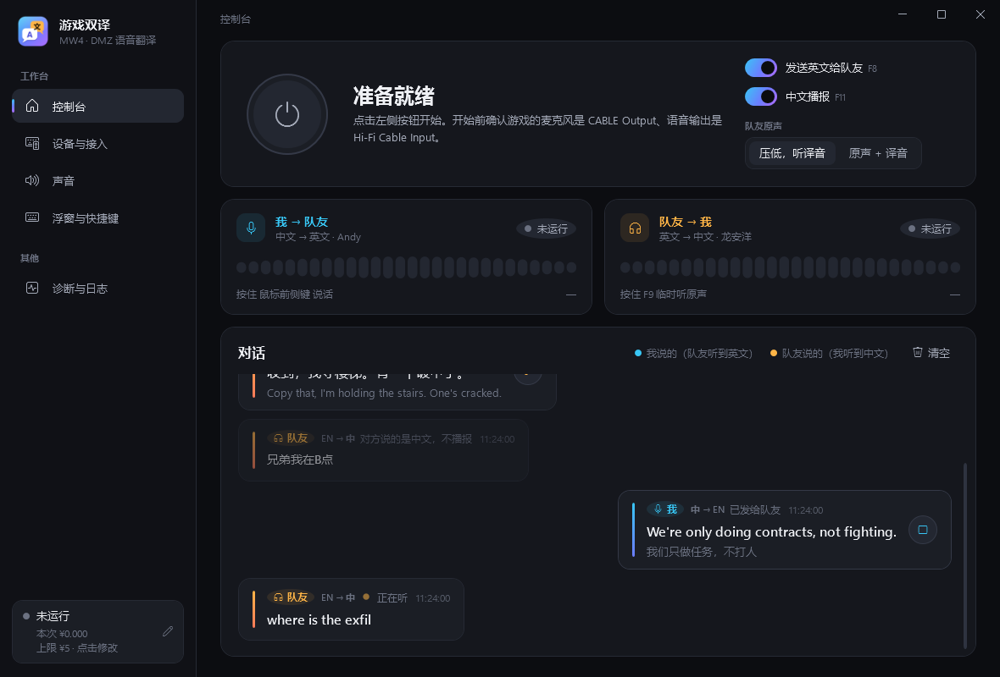
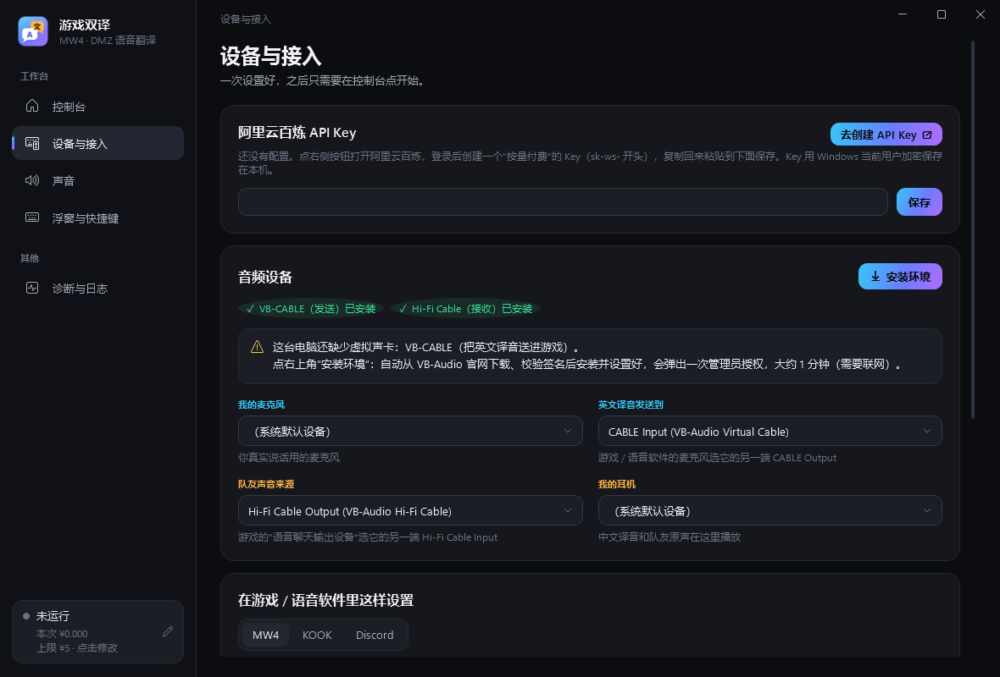
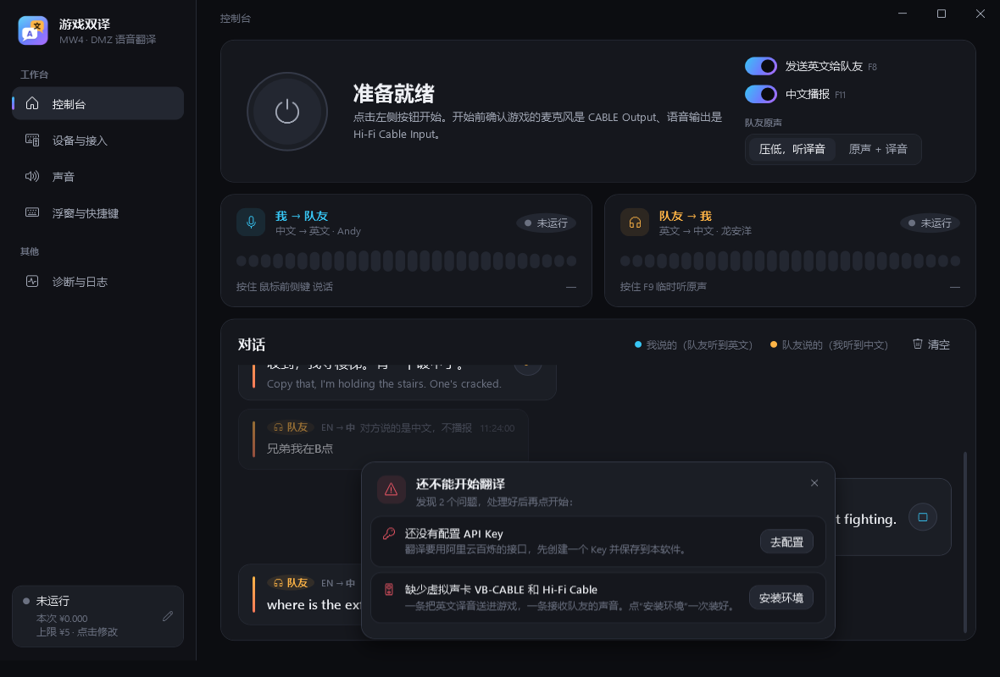
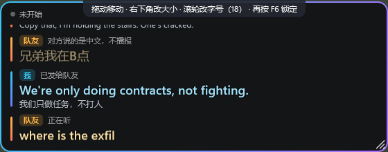
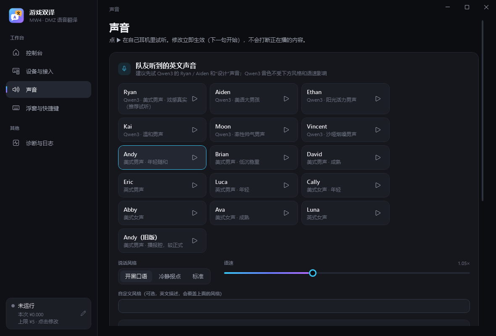
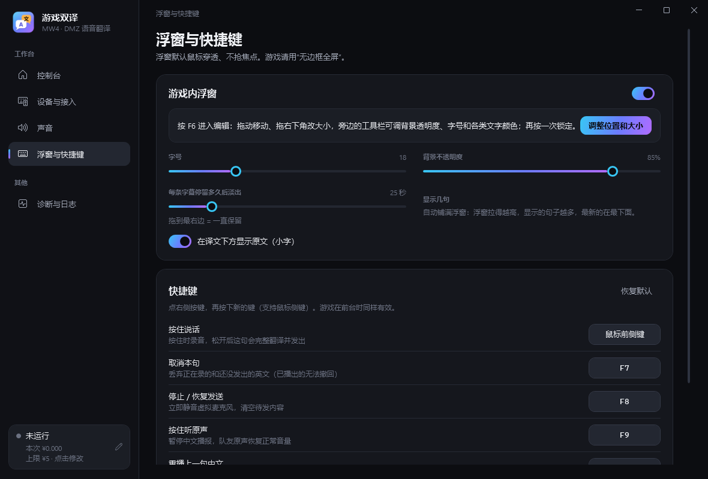
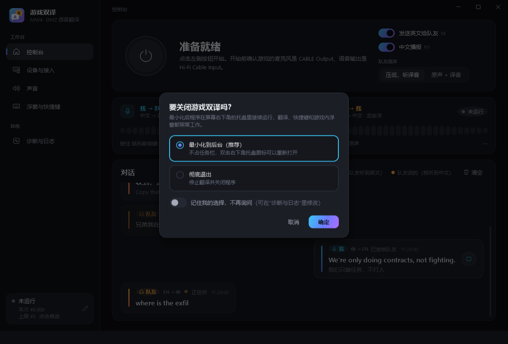

<div align="center">


# 游戏双译 · GameVoiceTranslator

**游戏内实时双向语音翻译：你说中文，队友听到英文；队友说英文，你在耳机里听到中文，游戏音效照常。**

[](https://github.com/FlippySun/GameVoiceTranslator/actions/workflows/ci.yml)
[](https://github.com/FlippySun/GameVoiceTranslator/releases/latest)
[](LICENSE)


[下载](#-下载与安装) · [快速开始](#-三步开始) · [功能](#-功能) · [常见问题](#-常见问题) · [参与开发](#-参与开发) · [English](#english)



</div>

---

## ✨ 功能

- **双向同声翻译**：按住说话键说中文，队友在游戏语音里听到自然口语化的英文；队友说英文，你在耳机里听到中文，同时保留压低的原声，不影响听脚步、枪声。
- **游戏黑话**：内置 COD DMZ 术语表（撤离、破甲、舔包、阔剑……），识别热词 + 翻译约束双管齐下；“吃 / 舔”会翻成 loot 而不是 eat。
- **防误播**：只是附和的语气词（yeah / okay）、半截话、听不清的碎片不播报；翻译没把握时提示“可能是……”；译文混入别的语言会自动重翻。
- **像真人的声音**：可选 Qwen3-TTS / CosyVoice 多种英文、中文音色，支持用一句话描述“设计”自己的声音。
- **游戏内字幕浮窗**：鼠标穿透、不抢焦点；按 F6 拖动、改大小、调透明度和配色，内容自动铺满浮窗。
- **新手友好**：
  - 缺虚拟声卡时一键“安装环境”，自动从 VB-Audio 官网下载、校验签名、安装并配置好设备
  - 点开始前自动检查 API Key、声卡、设备选择，缺什么一次列出并给出跳转按钮
  - 单次花费上限随时可调，到了自动暂停
  - 关闭窗口可最小化到右下角托盘，翻译和快捷键照常工作
- **安全**：不注入游戏、不 Hook DirectX，快捷键用 Raw Input；发送方向出错时虚拟麦克风只会静音，绝不会改发你的中文原声；主程序崩溃时守护进程自动恢复队友原声。

| 一键安装环境 | 开始前检查 | 字幕浮窗 |
|---|---|---|
|  |  |  |

| 声音 | 浮窗与快捷键 | 关闭时选择 |
|---|---|---|
|  |  |  |

## 🧭 工作原理

```
发送：你的麦克风 →（按住说话）→ 中文识别 → 中译英 → 英文合成 → 虚拟声卡 VB-CABLE → 游戏 / 语音软件把 CABLE Output 当麦克风
接收：游戏的“语音聊天输出”= 虚拟声卡 Hi-Fi Cable → 语音检测 → 英文识别 → 英译中 → 中文合成 ┐
                                              └→ 队友原声（压低，可按住放大）─────────┴→ 你的耳机
游戏音效：直接走游戏自己的输出设备到耳机，不经过本软件。
```

云端服务全部使用 **阿里云百炼（北京）**：`fun-asr-realtime` 实时识别（带游戏热词）、`qwen-flash` 翻译、`qwen3-tts-flash` / `qwen-audio-3.1-tts-flash` 合成。
平均每句从说完到对方开始听到约 **0.8 秒**。

## 📦 下载与安装

到 [Releases](https://github.com/FlippySun/GameVoiceTranslator/releases/latest) 下载 `GameVoiceTranslator-Setup-x.y.z.exe`，双击安装即可（自带运行环境，不需要另外装 .NET，也不需要管理员权限）。

> 安装包没有数字签名，Windows 可能提示“Windows 已保护你的电脑”，点 **更多信息 → 仍要运行**。

系统要求：Windows 10 / 11（64 位），能联网，一个阿里云百炼账号。

## 🚀 三步开始

1. **安装环境**：打开软件 →“设备与接入”→ 点 **安装环境**。软件会从 [VB-Audio 官网](https://vb-audio.com/Cable/)下载两条免费的虚拟声卡（VB-CABLE、Hi-Fi Cable），校验签名后安装（弹一次管理员授权），并自动选好设备。
2. **配置 API Key**：点 **去创建 API Key** 打开[阿里云百炼控制台](https://bailian.console.aliyun.com/cn-beijing/settings/api-key)，创建一个“按量付费”的 Key（`sk-ws-` 开头），粘贴回软件保存。Key 用 Windows 当前用户加密保存在本机。
3. **在游戏 / 语音软件里选设备**，然后回到控制台点开始：

| 软件 | 麦克风 / 输入设备 | 语音输出设备 | 其他 |
|---|---|---|---|
| COD MW4（设置 → 音频） | `CABLE Output (VB-Audio Virtual Cable)` | `Hi-Fi Cable Input (VB-Audio Hi-Fi Cable)` | 游戏音效设备保持耳机；语音录制选“开放麦克风”；显示模式用“无边框全屏” |
| KOOK | `CABLE Output` | `Hi-Fi Cable Input` | 自由麦；关闭降噪、回声消除、自动增益 |
| Discord | `CABLE Output` | `Hi-Fi Cable Input` | 语音激活并关闭“自动确定灵敏度”；关闭噪声抑制、回声消除、衰减 |

> 建议在 Windows 控制面板 → 声音 →“通信”页选“不执行任何操作”，否则 Windows 检测到通话时会把游戏音量压低。

### 快捷键（可在“浮窗与快捷键”里改）

| 按键 | 作用 |
|---|---|
| 鼠标前侧键（按住） | 说话；松开后这句会完整翻译并发出 |
| F7 | 取消本句（已经播出去的无法撤回） |
| F8 | 停止 / 恢复发送 |
| F9（按住） | 暂停中文播报，听队友原声 |
| F10 | 在自己耳机里重播上一句中文 |
| F11 | 停止 / 恢复中文播报 |
| F6 | 编辑浮窗：拖动、改大小、调样式；再按一次锁定 |

## 💰 费用

按阿里云百炼官方价格，实测一晚 2 小时开黑约 **¥1–5**（取决于队友说话多少）。左下角实时显示本次花费，点击可以设置单次上限（默认 ¥5，到了自动暂停，队友原声照常）。

## ❓ 常见问题

<details>
<summary>队友说的很多“yeah / okay”没有播报？</summary>

这是有意的：单纯附和的语气词、听不清的单个词和半截话只显示字幕，不播报，避免耳机里一直响。真正的报点（behind、sniper、push……）照常播报。
</details>

<details>
<summary>为什么不能用 Token Plan / Coding Plan 的 sk-sp- Key？</summary>

那类 Key 只允许在开发工具里交互使用，也不包含实时语音识别和合成。请创建“按量付费”的 Key（`sk-ws-` 开头）。
</details>

<details>
<summary>安装虚拟声卡后，电脑的声音跑到虚拟声卡里了？</summary>

“安装环境”会在安装后自动把 Windows 默认设备恢复成安装前的样子。如果你是手动安装的，请在 Windows 声音设置里把默认播放设备改回耳机。
</details>

<details>
<summary>会被反作弊检测吗？</summary>

本软件不注入游戏进程、不读写游戏内存、不 Hook 图形接口；快捷键用系统 Raw Input 读取，浮窗是普通的置顶透明窗口。它在游戏看来只是一个麦克风设备。注意：COD 有 AI 语音审核，你的英文译音会以你的账号身份被审核。
</details>

<details>
<summary>我的语音和 Key 会上传到哪里？</summary>

语音只发送到阿里云百炼做识别、翻译和合成。API Key 用 Windows DPAPI 加密保存在 `%APPDATA%\GameVoiceTranslator`。“保存识别音频”默认关闭，打开后录音也只保存在本机日志目录。
</details>

## 🛠 参与开发

需要 Windows 10/11 和 [.NET 10 SDK](https://dotnet.microsoft.com/download)。

```powershell
git clone https://github.com/FlippySun/GameVoiceTranslator.git
cd GameVoiceTranslator
dotnet build
dotnet test                                   # 单元测试（不需要网络和声卡）
dotnet run --project src/GVT.App              # 运行
powershell -File installer\build-installer.ps1  # 生成安装包（需要 Inno Setup 6）
```

```
src/GVT.Core      核心：音频采集/混音/有序播放队列/VAD、阿里云客户端、双通道调度与取消、环境检查
src/GVT.App       WPF 界面、游戏内字幕浮窗、托盘、Raw Input 快捷键、一键安装环境
src/GVT.Watchdog  崩溃守护：主程序意外退出时恢复队友原声
src/GVT.Replay    离线测试工具：翻译语料回归、识别方案对比、完整链路延迟、真实录音回放
tests/GVT.Tests   单元测试
corpus/           中英关键语义测试语料
installer/        Inno Setup 安装包脚本
```

`GVT.Replay` 常用命令：`mt corpus/zh2en.tsv`（翻译回归）、`run <录音目录> --dir en2zh`（真实录音整链回放）、`asr-ab <录音目录>`（识别方案对比）、`env-check`（开始前检查）。

欢迎提 Issue 和 PR，详见 [CONTRIBUTING.md](CONTRIBUTING.md)。

## 📄 许可

本项目以 [GPL-3.0](LICENSE) 协议开源。第三方组件见 [THIRD_PARTY_NOTICES.md](THIRD_PARTY_NOTICES.md)。

虚拟声卡 VB-CABLE、Hi-Fi Cable 是 [VB-Audio](https://vb-audio.com) 的捐赠软件，**不包含在本项目和安装包中**，由软件在你点击“安装环境”时从 VB-Audio 官网下载。如果它们对你有用，欢迎向 VB-Audio 捐赠支持。

本项目与 Activision、Call of Duty、阿里云均无关联。

---

## English

**GameVoiceTranslator** is a Windows app for real-time, two-way voice translation in multiplayer games. You speak Chinese and your teammates hear natural English in game voice chat; they speak English and you hear Chinese in your headphones, while game audio stays untouched. It routes audio through two virtual audio cables (VB-Audio VB-CABLE and Hi-Fi Cable, downloaded from the official site on demand), and uses Alibaba Cloud Model Studio (DashScope) for streaming ASR, LLM translation and TTS. Built with C# / .NET 10 / WPF, licensed under GPL-3.0. The UI is currently Chinese only.
